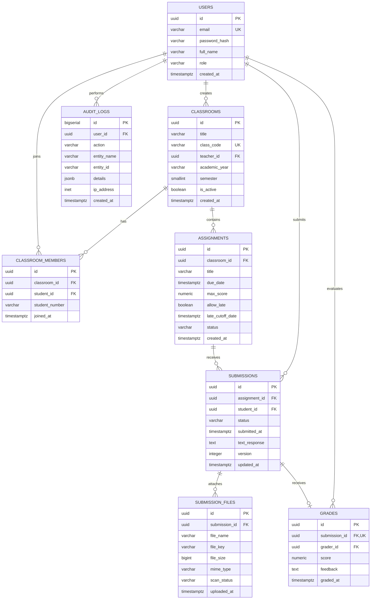

# Database Design Specification
## ระบบเช็คและตรวจการบ้านออนไลน์ (Homework Tracking & Grading System)

---

### 1. แผนภาพความสัมพันธ์ของข้อมูล (Entity-Relationship Diagram - ERD)



---

### 2. นิยามโครงสร้างตาราง (Table Schemas / DDL)

ใช้ฐานข้อมูล **PostgreSQL 16+** พร้อมเปิดใช้งาน Extension `uuid-ossp` สำหรับการสร้าง UUID v4:

```sql
-- เปิดส่วนขยายสำหรับ UUID
CREATE EXTENSION IF NOT EXISTS "uuid-ossp";

-- สร้าง Custom Enum Types
CREATE TYPE user_role AS ENUM ('admin', 'teacher', 'student');
CREATE TYPE assignment_status AS ENUM ('draft', 'published', 'closed');
CREATE TYPE submission_status AS ENUM ('submitted', 'late', 'graded', 'resubmitted');
CREATE TYPE file_scan_status AS ENUM ('pending', 'clean', 'infected');

-- 1. ตารางข้อมูลผู้ใช้ (users)
CREATE TABLE users (
    id UUID PRIMARY KEY DEFAULT uuid_generate_v4(),
    email VARCHAR(255) UNIQUE NOT NULL,
    password_hash VARCHAR(255) NOT NULL,
    full_name VARCHAR(150) NOT NULL,
    role user_role NOT NULL,
    avatar_url VARCHAR(500),
    created_at TIMESTAMPTZ NOT NULL DEFAULT (NOW() AT TIME ZONE 'UTC'),
    updated_at TIMESTAMPTZ NOT NULL DEFAULT (NOW() AT TIME ZONE 'UTC')
);

-- 2. ตารางห้องเรียน / รายวิชา (classrooms)
CREATE TABLE classrooms (
    id UUID PRIMARY KEY DEFAULT uuid_generate_v4(),
    title VARCHAR(200) NOT NULL,
    description TEXT,
    subject_code VARCHAR(50),
    class_code VARCHAR(10) UNIQUE NOT NULL,
    teacher_id UUID NOT NULL REFERENCES users(id) ON DELETE RESTRICT,
    academic_year VARCHAR(10) NOT NULL,
    semester SMALLINT NOT NULL CHECK (semester BETWEEN 1 AND 3),
    is_active BOOLEAN NOT NULL DEFAULT TRUE,
    created_at TIMESTAMPTZ NOT NULL DEFAULT (NOW() AT TIME ZONE 'UTC'),
    updated_at TIMESTAMPTZ NOT NULL DEFAULT (NOW() AT TIME ZONE 'UTC')
);

-- 3. ตารางสมาชิกในห้องเรียน (classroom_members)
CREATE TABLE classroom_members (
    id UUID PRIMARY KEY DEFAULT uuid_generate_v4(),
    classroom_id UUID NOT NULL REFERENCES classrooms(id) ON DELETE CASCADE,
    student_id UUID NOT NULL REFERENCES users(id) ON DELETE CASCADE,
    student_number VARCHAR(50),
    joined_at TIMESTAMPTZ NOT NULL DEFAULT (NOW() AT TIME ZONE 'UTC'),
    CONSTRAINT uq_classroom_student UNIQUE (classroom_id, student_id)
);

-- 4. ตารางการบ้าน / งานที่มอบหมาย (assignments)
CREATE TABLE assignments (
    id UUID PRIMARY KEY DEFAULT uuid_generate_v4(),
    classroom_id UUID NOT NULL REFERENCES classrooms(id) ON DELETE CASCADE,
    title VARCHAR(250) NOT NULL,
    description TEXT,
    due_date TIMESTAMPTZ NOT NULL,
    max_score NUMERIC(5, 2) NOT NULL CHECK (max_score > 0),
    allow_late BOOLEAN NOT NULL DEFAULT FALSE,
    late_cutoff_date TIMESTAMPTZ,
    status assignment_status NOT NULL DEFAULT 'draft',
    attachment_url VARCHAR(500),
    created_at TIMESTAMPTZ NOT NULL DEFAULT (NOW() AT TIME ZONE 'UTC'),
    updated_at TIMESTAMPTZ NOT NULL DEFAULT (NOW() AT TIME ZONE 'UTC'),
    CONSTRAINT chk_late_cutoff CHECK (late_cutoff_date IS NULL OR late_cutoff_date >= due_date)
);

-- 5. ตารางการส่งการบ้าน (submissions)
CREATE TABLE submissions (
    id UUID PRIMARY KEY DEFAULT uuid_generate_v4(),
    assignment_id UUID NOT NULL REFERENCES assignments(id) ON DELETE CASCADE,
    student_id UUID NOT NULL REFERENCES users(id) ON DELETE CASCADE,
    status submission_status NOT NULL DEFAULT 'submitted',
    submitted_at TIMESTAMPTZ NOT NULL DEFAULT (NOW() AT TIME ZONE 'UTC'),
    text_response TEXT,
    version INTEGER NOT NULL DEFAULT 1 CHECK (version >= 1),
    created_at TIMESTAMPTZ NOT NULL DEFAULT (NOW() AT TIME ZONE 'UTC'),
    updated_at TIMESTAMPTZ NOT NULL DEFAULT (NOW() AT TIME ZONE 'UTC'),
    CONSTRAINT uq_assignment_student UNIQUE (assignment_id, student_id)
);

-- 6. ตารางไฟล์แนบของการส่งงาน (submission_files)
CREATE TABLE submission_files (
    id UUID PRIMARY KEY DEFAULT uuid_generate_v4(),
    submission_id UUID NOT NULL REFERENCES submissions(id) ON DELETE CASCADE,
    file_name VARCHAR(255) NOT NULL,
    file_key VARCHAR(500) NOT NULL,
    file_size BIGINT NOT NULL CHECK (file_size > 0 AND file_size <= 26214400), -- สูงสุด 25 MB (26,214,400 bytes)
    mime_type VARCHAR(100) NOT NULL,
    checksum_sha256 VARCHAR(64),
    scan_status file_scan_status NOT NULL DEFAULT 'pending',
    uploaded_at TIMESTAMPTZ NOT NULL DEFAULT (NOW() AT TIME ZONE 'UTC')
);

-- 7. ตารางการตรวจและบันทึกคะแนน (grades)
CREATE TABLE grades (
    id UUID PRIMARY KEY DEFAULT uuid_generate_v4(),
    submission_id UUID UNIQUE NOT NULL REFERENCES submissions(id) ON DELETE CASCADE,
    grader_id UUID NOT NULL REFERENCES users(id) ON DELETE RESTRICT,
    score NUMERIC(5, 2) NOT NULL CHECK (score >= 0),
    feedback TEXT,
    graded_at TIMESTAMPTZ NOT NULL DEFAULT (NOW() AT TIME ZONE 'UTC'),
    updated_at TIMESTAMPTZ NOT NULL DEFAULT (NOW() AT TIME ZONE 'UTC')
);

-- 8. ตารางประวัติการทำธุรกรรม (audit_logs)
CREATE TABLE audit_logs (
    id BIGSERIAL PRIMARY KEY,
    user_id UUID REFERENCES users(id) ON DELETE SET NULL,
    action VARCHAR(100) NOT NULL,
    entity_name VARCHAR(50) NOT NULL,
    entity_id VARCHAR(64) NOT NULL,
    details JSONB,
    ip_address INET,
    created_at TIMESTAMPTZ NOT NULL DEFAULT (NOW() AT TIME ZONE 'UTC')
);
```

---

### 3. พจนานุกรมข้อมูล (Data Dictionary)

| ตาราง (Table) | ฟิลด์ (Field) | ชนิดข้อมูล (Data Type) | Nullable | คำอธิบาย (Description) |
|---|---|---|:---:|---|
| **users** | `id` | UUID | NO | รหัสผู้ใช้งาน (Primary Key) |
| | `email` | VARCHAR(255) | NO | อีเมลเข้าสู่ระบบ (Unique) |
| | `role` | user_role | NO | บทบาทผู้ใช้ (`teacher`, `student`, `admin`) |
| **classrooms** | `class_code` | VARCHAR(10) | NO | รหัส 6-8 หลักสำหรับนักเรียนใช้กรอกเข้าห้องเรียน |
| | `teacher_id` | UUID | NO | รหัสครูผู้สอนเจ้าของห้อง (FK -> users) |
| **assignments** | `due_date` | TIMESTAMPTZ | NO | กำหนดวันเวลาส่งงาน (UTC) |
| | `max_score` | NUMERIC(5,2) | NO | คะแนนเต็มของงาน (เช่น 10.00, 100.00) |
| | `allow_late` | BOOLEAN | NO | อนุญาตให้ส่งหลังกำหนดหรือไม่ |
| **submissions** | `status` | submission_status | NO | สถานะ: `submitted`, `late`, `graded`, `resubmitted` |
| | `submitted_at` | TIMESTAMPTZ | NO | เวลาที่ส่งงานจริง อิง Server Clock UTC |
| | `version` | INTEGER | NO | เลขเวอร์ชันการส่งงาน (เริ่มที่ 1 เพิ่มเมื่อ resubmit) |
| **submission_files**| `file_key` | VARCHAR(500) | NO | Path อ้างอิงไฟล์ใน Object Storage (S3 Key) |
| | `file_size` | BIGINT | NO | ขนาดไฟล์เป็น Bytes (ต้องไม่เกิน 25 MB) |
| **grades** | `score` | NUMERIC(5,2) | NO | คะแนนที่ได้ (ตรวจสอบไม่เกิน max_score ผ่าน Logic/Trigger) |
| | `feedback` | TEXT | YES | ข้อเสนอแนะจากครูผู้ตรวจ |

---

### 4. การวิเคราะห์ Normalization (3NF & BCNF Validation)

- **1NF (First Normal Form):** ทุก Attribute เก็บค่าเดี่ยว (Atomic Values) ไม่มีการเก็บ Array ของไฟล์ในตาราง Submission แต่แยกเป็นตาราง `submission_files` 
- **2NF (Second Normal Form):** ตารางทุกตารางมี Single Primary Key (UUID) ไม่มี Partial Dependency บน Composite Key
- **3NF (Third Normal Form):** ไม่มี Transitive Dependency เช่น ข้อมูลครูผู้สอนไม่ได้บันทึกซ้ำใน `assignments` แต่เชื่อมโยงผ่าน `classrooms.teacher_id`
- **BCNF (Boyce-Codd Normal Form):** ทุก Determinant ในระบบเป็น Superkey ปราศจากความผิดปกติในการ Insert/Update/Delete

---

### 5. กลยุทธ์การทำ Index (Indexing Strategy for Query Patterns)

ดัชนีถูกออกแบบมาเพื่อรองรับ Query สำคัญช่วงการส่งงานและการเปิดดูตารางคะแนน:

```sql
-- 1. ค้นหาห้องเรียนที่ครูคนนี้สอน
CREATE INDEX idx_classrooms_teacher ON classrooms(teacher_id) WHERE is_active = TRUE;

-- 2. ค้นหานักเรียนในห้อง และห้องที่นักเรียนเข้าร่วม
CREATE INDEX idx_classroom_members_student ON classroom_members(student_id);

-- 3. ค้นหาการบ้านของห้องเรียน เรียงตามกำหนดส่ง
CREATE INDEX idx_assignments_classroom_due ON assignments(classroom_id, due_date DESC);

-- 4. ค้นหาสถานะการส่งงานของนักเรียนในห้อง (Query หนักช่วงเช็คงาน)
CREATE INDEX idx_submissions_assign_status ON submissions(assignment_id, status);

-- 5. ค้นหางานส่งของนักเรียนรายบุคคล (หน้าจอ My Homework)
CREATE INDEX idx_submissions_student_lookup ON submissions(student_id, submitted_at DESC);

-- 6. การดึงไฟล์แนบของการส่งงาน
CREATE INDEX idx_subfiles_submission ON submission_files(submission_id);

-- 7. ค้นหาประวัติ Audit Log ตาม Entity
CREATE INDEX idx_audit_logs_entity ON audit_logs(entity_name, entity_id);
```

---

### 6. ขอบเขตธุรกรรมและความถูกต้องของข้อมูล (Transaction Boundaries)

#### 6.1 การบันทึกส่งการบ้าน (Submit Assignment Transaction)
ต้องป้องกัน Race Condition และยืนยันความสมบูรณ์ของไฟล์แนบพร้อมกัน:

```sql
BEGIN;

-- 1. ตรวจสอบสถานะการบ้านและล็อกอ่านเพื่อป้องกันการเปลี่ยน Deadline ระหว่างส่ง
SELECT id, due_date, allow_late, late_cutoff_date, status 
FROM assignments 
WHERE id = :assignment_id AND status = 'published'
FOR SHARE;

-- 2. บันทึกหรืออัปเดตการส่งงาน (Upsert)
INSERT INTO submissions (id, assignment_id, student_id, status, submitted_at, version)
VALUES (
    :submission_id, 
    :assignment_id, 
    :student_id, 
    CASE 
        WHEN NOW() AT TIME ZONE 'UTC' <= :due_date THEN 'submitted'::submission_status
        ELSE 'late'::submission_status
    END,
    NOW() AT TIME ZONE 'UTC',
    1
)
ON CONFLICT (assignment_id, student_id) DO UPDATE SET
    status = EXCLUDED.status,
    submitted_at = EXCLUDED.submitted_at,
    version = submissions.version + 1,
    updated_at = NOW() AT TIME ZONE 'UTC';

-- 3. บันทึกรายการไฟล์แนบ
INSERT INTO submission_files (submission_id, file_name, file_key, file_size, mime_type, checksum_sha256)
VALUES (:submission_id, :file_name, :file_key, :file_size, :mime_type, :checksum);

-- 4. บันทึกประวัติใน Audit Log
INSERT INTO audit_logs (user_id, action, entity_name, entity_id, details)
VALUES (:student_id, 'SUBMIT_HOMEWORK', 'submission', :submission_id, json_build_object('version', 1));

COMMIT;
```

#### 6.2 การตรวจและให้คะแนน (Grading Transaction)
ต้องตรวจสอบว่าคะแนนไม่เกินคะแนนเต็มของการบ้านนั้น:

```sql
BEGIN;

-- 1. ตรวจสอบคะแนนเต็มของการบ้าน
SELECT a.max_score 
FROM assignments a
JOIN submissions s ON s.assignment_id = a.id
WHERE s.id = :submission_id;

-- ตรวจสอบใน Application Layer: :score <= a.max_score

-- 2. บันทึกผลคะแนนลงตาราง grades
INSERT INTO grades (submission_id, grader_id, score, feedback, graded_at)
VALUES (:submission_id, :teacher_id, :score, :feedback, NOW() AT TIME ZONE 'UTC')
ON CONFLICT (submission_id) DO UPDATE SET
    score = EXCLUDED.score,
    feedback = EXCLUDED.feedback,
    graded_at = NOW() AT TIME ZONE 'UTC',
    updated_at = NOW() AT TIME ZONE 'UTC';

-- 3. ปรับสถานะงานเป็น Graded
UPDATE submissions 
SET status = 'graded', updated_at = NOW() AT TIME ZONE 'UTC'
WHERE id = :submission_id;

-- 4. บันทึก Audit Log
INSERT INTO audit_logs (user_id, action, entity_name, entity_id, details)
VALUES (:teacher_id, 'GRADE_SUBMISSION', 'grade', :submission_id, json_build_object('score', :score));

COMMIT;
```

---

### 7. แผนการ Migration และการจัดการข้อมูลสำรอง (Migration & Backup Strategy)

1. **Migration Framework:**
   - ใช้เครื่องมือ Version-controlled Database Migration (เช่น **Prisma Migrate**, **TypeORM**, หรือ **Golang Migrate**)
   - ทุก Migration Script ต้องมีทั้งคำสั่ง `UP` (สร้าง/แก้ไข) และ `DOWN` (Rollback ย้อนกลับ)
2. **Zero-downtime Schema Changes:**
   - ห้ามใช้คำสั่ง `ALTER TABLE ... DROP COLUMN` หรือ `RENAME` โดยตรงใน Production
   - ให้ใช้แนวทาง Expand-Contract Pattern: เพิ่มฟิลด์ใหม่ -> Sync ข้อมูล -> สลับให้แอปอ่านฟิลด์ใหม่ -> จึงค่อยลบฟิลด์เดิมใน Sprint ถัดไป
3. **Automated Backup Strategy:**
   - **Continuous WAL Archiving (Write-Ahead Logging):** สำหรับ Point-in-Time Recovery (PITR) กู้ข้อมูลย้อนหลังได้ระดับวินาที ย้อนหลัง 7 วัน
   - **Full Daily Snapshot:** สำรองข้อมูลเต็มรูปแบบอัตโนมัติทุกคืนเวลา 02:00 UTC และย้ายไปจัดเก็บข้าม Region (Cross-region Disaster Recovery)

---

### 8. ความเสี่ยงด้านประสิทธิภาพของฐานข้อมูล (Database Performance Risks & Mitigations)

| ความเสี่ยงด้านประสิทธิภาพ | ผลกระทบ | แนวทางแก้ไขและป้องกัน (Mitigation) |
|---|---|---|
| **Connection Exhaustion ช่วงใกล้ Deadline** | แอปพลิเคชันต่อ DB ไม่ได้ เกิดข้อผิดพลาด 500 | ติดตั้ง **PgBouncer** เป็น Connection Pooler ด้านหน้า PostgreSQL จำกัด Max Active Connections ไว้ที่ 100–200 connections |
| **ตาราง Audit Log โตเร็วเกินไป** | Disk เต็ม และ Query ประวัติช้าลง | ทำ **Table Partitioning ตามเดือน** (`audit_logs_y2026m09`, ...) และตั้ง Cronjob ย้าย Log เก่ากว่า 1 ปีเข้า Data Lake |
| **Query ตารางคะแนนรวมทั้งห้องล่าช้า** | หน้ารายงานเกรดโหลดช้าเมื่อมีนักเรียนจำนวนมาก | ใช้ Materialized View หรือ Redis Cache สำหรับเก็บคะแนนสรุปห้องเรียน และ Invalidate แคชเฉพาะเมื่อมีการบันทึกเกรด |

---
*เอกสารนี้จัดทำตามมาตรฐาน **04-database-design** เพื่อส่งต่อให้นักพัฒนาใช้สร้าง Schema และเชื่อมต่อกับ **05-api-design** ต่อไป*
