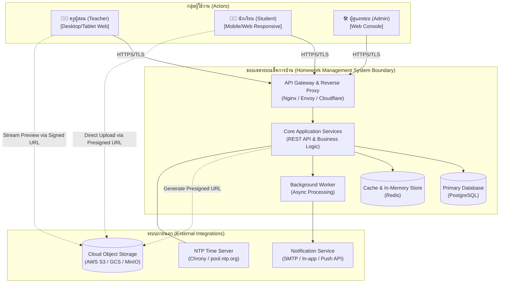
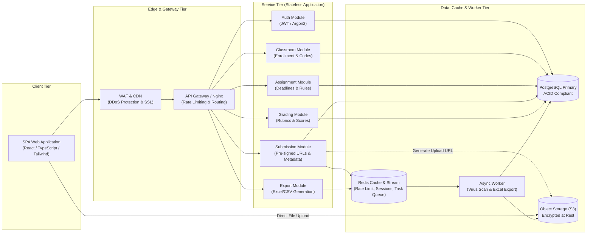
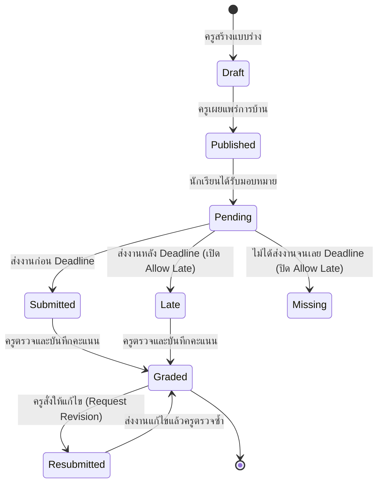
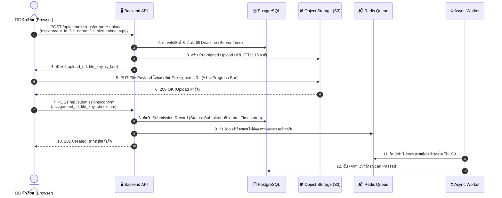
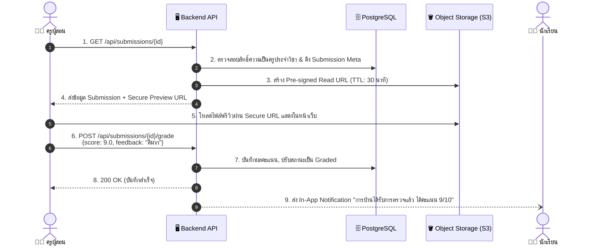

# System Architecture & Design Specification
## ระบบเช็คและตรวจการบ้านออนไลน์ (Homework Tracking & Grading System)

---

### 1. บริบทของระบบและขอบเขต (System Context & Boundaries)

ระบบถูกออกแบบมาเพื่อเป็นศูนย์กลางการจัดการการบ้าน การตรวจงาน และการประเมินผลสำหรับสถานศึกษา โดยกำหนดบริบทและการปฏิสัมพันธ์กับผู้ใช้และระบบภายนอกดังนี้:

#### Trust Boundaries (ขอบเขตความปลอดภัย):
1. **Public/Untrusted Zone:** Client Browser/Mobile App ของนักเรียนและครู
2. **DMZ / Ingress Zone:** Cloudflare WAF, TLS Termination, และ Rate Limiter
3. **Internal Trusted Zone:** Core Application Pods, Database Cluster, Background Workers, และ Redis Cache
4. **Third-Party / Managed Cloud Zone:** Object Storage (S3) ควบคุมการเข้าถึงด้วย IAM Role และ Presigned URL ชั่วคราว (TTL 15 นาที)

---

### 2. สถาปัตยกรรมภาพรวมระดับสูง (High-Level Architecture)

สถาปัตยกรรมของระบบเป็นแบบ **Modular Layered Architecture** ที่แยกส่วน Frontend, Backend API, Database, และ Asynchronous Processing เพื่อรองรับการสเกลแยกส่วนเมื่อเกิด Traffic Spike:

---

### 3. ส่วนประกอบสำคัญและความรับผิดชอบ (Component Responsibilities)

| ชื่อ Component | หน้าที่และความรับผิดชอบ (Responsibilities) | เทคโนโลยีที่แนะนำ |
|---|---|---|
| **Web Frontend (SPA)** | - นำเสนอ UI แบบ Responsive รองรับ Desktop & Mobile - จัดการ Form Validation, File Picker, และแสดง Upload Progress Bar - เรนเดอร์ File Preview (PDF/Image) ให้ครูตรวจงาน | React / Vite, Tailwind CSS, pdfjs |
| **API Gateway / Ingress** | - ทำ TLS Termination และบล็อกการโจมตี DDoS/Brute-force - ตรวจสอบ Rate Limiting (จำกัด 60 req/min ต่อ IP สำหรับ Upload Request) - Route traffic ไปยัง Application Instances | Nginx หรือ Traefik |
| **Core API Service** | - ประมวลผล Business Rules (เช่น ตรวจสอบ Deadline, คำนวณสถานะ Late) - ควบคุมสิทธิ์การเข้าถึงข้อมูล (RBAC / Row-level permission) - สร้าง Presigned URL สำหรับอัปโหลดและดาวน์โหลดไฟล์ | Node.js (NestJS/Express) หรือ Go / Python FastAPI |
| **PostgreSQL Database** | - จัดเก็บข้อมูลเชิงสัมพันธ์: ผู้ใช้, ห้องเรียน, การบ้าน, การส่งงาน, คะแนน - รับประกันความสอดคล้องของข้อมูล (ACID Transaction) ในการบันทึกเวลาส่งงาน | PostgreSQL 16+ |
| **Redis In-Memory Store** | - บันทึก Blacklist Tokens / Session Cache - ทำงานเป็น Distributed Rate Limiter - ทำหน้าที่เป็น Message Queue / Job Queue สำหรับงาน Asynchronous | Redis 7+ |
| **Async Background Worker** | - ประมวลผลงานหนักที่ใช้เวลานาน: สร้างไฟล์ Excel Export สรุปคะแนน - สแกนไวรัสไฟล์ที่อัปโหลดเข้า Bucket (ClamAV integration) - ส่ง Notification หรืออีเมลแจ้งเตือน | BullMQ Worker / Celery |
| **Cloud Object Storage** | - จัดเก็บไฟล์การบ้านและไฟล์โจทย์อย่างปลอดภัย - เข้ารหัสไฟล์ Server-Side Encryption (SSE-S3) - รองรับ Lifecycle Rule เพื่อย้ายไฟล์เก่าเข้า Cold Storage | AWS S3 / MinIO |

---

### 4. การไหลของข้อมูล (Data Flow Architecture)

#### 4.1 ข้อมูลการสร้างและการส่งการบ้าน (Assignment & Submission Lifecycle)

---

### 5. ลำดับการทำงานของ Use Case สำคัญ (Sequence Diagrams)

#### 5.1 Use Case: การส่งการบ้านด้วย Direct-to-Storage Upload (รองรับ Peak Load)
แนวทางนี้ป้องกันเซิร์ฟเวอร์ล่มเมื่อนักเรียนแห่ส่งงานพร้อมกันก่อน Deadline โดยให้เบราว์เซอร์อัปโหลดไฟล์ตรงเข้า S3:

#### 5.2 Use Case: ครูตรวจงานและให้คะแนน (Grading & Preview Flow)

---

### 6. กลยุทธ์การรองรับโหลดสูง (Scalability Strategy)

ช่วงเวลา 15–30 นาทีก่อนกำหนดส่งการบ้าน (Deadline) มักเกิดปรากฏการณ์ **Traffic Spike** ระบบจึงมีกลยุทธ์รองรับดังนี้:

1. **Decoupled File Ingestion (การแยกภาระการรับไฟล์):**
   - ไฟล์การบ้านขนาด 5–25 MB จะไม่ไหลผ่าน API Gateway หรือ Application Server แต่จะถูกส่งตรงเข้า Object Storage ผ่าน Pre-signed URL ช่วยประหยัด Network Bandwidth และ RAM ของ Application Pods ได้มากกว่า 90%
2. **Stateless Core API Instances:**
   - เซิร์ฟเวอร์ API ไม่มีสถานะผูกติดในเครื่อง (Stateless) ทำให้สามารถตั้ง **Kubernetes HPA (Horizontal Pod Autoscaler)** เพิ่ม Pod อัตโนมัติเมื่อ CPU เกิน 70% หรือ Network Request สูงขึ้น
3. **Database Read/Write Optimization:**
   - ใช้ Connection Pooling (เช่น PgBouncer) เพื่อควบคุมปริมาณ Database Connections ในช่วง Peak
   - ดัชนีฐานข้อมูล (Indexes) สำหรับการค้นหาสำคัญ เช่น `(assignment_id, student_id)`, `(classroom_id, status)`
4. **Caching Strategy (Redis):**
   - แคชข้อมูลรายละเอียดการบ้าน (Assignment Details) และรายชื่อนักเรียนในห้อง เพราะเป็นข้อมูลที่อ่านซ้ำ ๆ (Read-heavy) แต่เปลี่ยนแปลงน้อย

---

### 7. แผนความพร้อมใช้งานและการรับมือข้อผิดพลาด (Availability & Resilience Plan)

| กรณีเกิดความล้มเหลว (Failure Scenario) | ผลกระทบที่อาจเกิด | กลไกป้องกันและกู้คืน (Resilience Strategy) |
|---|---|---|
| **อินเทอร์เน็ตของนักเรียนหลุดระหว่างอัปโหลดไฟล์** | อัปโหลดไม่เสร็จ ไฟล์ค้างใน S3 | - Client ทำ Resumable / Chunked Upload สำหรับไฟล์ขนาดใหญ่ - ตั้ง S3 Lifecycle Rule ลบ Multipart Upload ที่ไม่สมบูรณ์ทิ้งภายใน 24 ชม. - การบันทึกสถานะใน Database จะเกิดขึ้นเฉพาะเมื่อยืนยัน Confirmation สำเร็จเท่านั้น |
| **ฐานข้อมูล Primary Database ล่ม** | ระบบไม่สามารถบันทึกข้อมูลได้ | - ใช้ Multi-AZ Replication (Primary-Standby) พร้อม Automatic Failover ภายในไม่เกิน 60 วินาที - ทำ Automated Daily Backup พร้อม Point-in-Time Recovery (PITR) 7 วัน |
| **Object Storage ชั่วคราวไม่ตอบสนอง** | ขอ Pre-signed URL ไม่ได้ | - ทำ Circuit Breaker (Resilience4j / Opossum) แจ้งเตือนข้อความที่เป็นมิตรแก่นักเรียนและให้ลองใหม่อัตโนมัติ (Exponential Backoff Retry) |
| **เวลาเครื่อง Server คลาดเคลื่อน** | การตัดสินสถานะส่งช้าผิดพลาด | - บังคับใช้งาน NTP Daemon (Chrony) ซิงก์เวลาจาก Time Server กลาง และใช้ฟังก์ชัน `NOW() AT TIME ZONE 'UTC'` ใน Database เท่านั้น |

---

### 8. ขอบเขตความปลอดภัย (Security Architecture)

1. **การป้องกันการเข้าถึงข้อมูลโดยไม่ได้รับอนุญาต (IDOR Defense):**
   - ทุก Endpoint ที่เข้าถึง Submission ต้องมี Authorization Middleware ตรวจสอบ:
     - ถ้านักเรียนเรียกดู ต้องเป็น `submission.student_id == current_user.id` เท่านั้น
     - ถ้าครูเรียกดู ต้องเป็น `classroom.teacher_id == current_user.id` เท่านั้น
2. **ความปลอดภัยของไฟล์แนบ (File Storage Security):**
   - ตั้งค่า S3 Bucket เป็น **Private 100%** (Block Public Access)
   - ไฟล์จะถูกเข้าถึงได้เฉพาะผ่าน Temporary Pre-signed URL ที่มีอายุสั้นเท่านั้น (Upload URL: 15 นาที, Preview URL: 30 นาที)
   - ตรวจสอบ Content-Length และ Magic Bytes ป้องกันการเปลี่ยนนามสกุลไฟล์
3. **Audit Trail & Non-repudiation:**
   - บันทึกตาราง `audit_logs` สำหรับการเปลี่ยนสถานะการส่งงาน การแก้ไขคะแนน และการตรวจงาน เพื่อใช้เป็นหลักฐานกรณีมีข้อโต้แย้ง

---

### 9. การเปรียบเทียบทางเลือกในการออกแบบ (Design Trade-offs)

| มิติการตัดสินใจ | ทางเลือกที่ 1 (เลือกใช้) | ทางเลือกที่ 2 (ไม่เลือก) | เหตุผลและข้อพิจารณา (Rationale & Trade-off) |
|---|---|---|---|
| **รูปแบบการอัปโหลดไฟล์** | **Direct to S3 via Pre-signed URL** | อัปโหลดผ่าน Backend API Server | ทางเลือกที่ 1 ซับซ้อนกว่าเล็กน้อยเพราะต้องมี 2-step (ขอ URL -> ยืนยัน) แต่แก้ปัญหาคอขวด Bandwidth และป้องกัน Server ล่มช่วง Peak Load ได้เด็ดขาด |
| **รูปแบบสถาปัตยกรรม** | **Modular Monolith (แยก Service Tier ได้)** | Microservices เต็มรูปแบบ | Modular Monolith ง่ายต่อการพัฒนาและ Deployment ในระยะแรก ไม่เพิ่มความซับซ้อนของ Distributed Tracing และ Network Latency แต่ยังรองรับการแยก Worker ได้ |
| **ระบบฐานข้อมูล** | **Relational Database (PostgreSQL)** | NoSQL (MongoDB) | การจัดการคะแนน สถานะการส่ง และการลงทะเบียนต้องการ ACID Transaction และความถูกต้องทางการเงิน/การศึกษาอย่างเคร่งครัด จึงเลือก RDBMS |

---
*เอกสารนี้จัดทำตามมาตรฐาน **02-system-design** เพื่อใช้เชื่อมต่อกับ **04-database-design** และ **05-api-design** ในขั้นตอนต่อไป*
